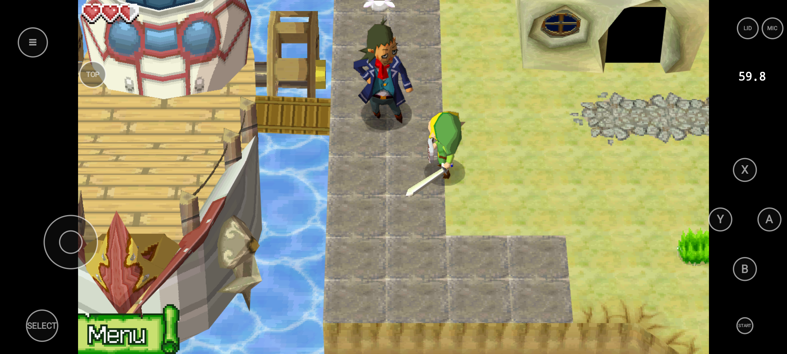
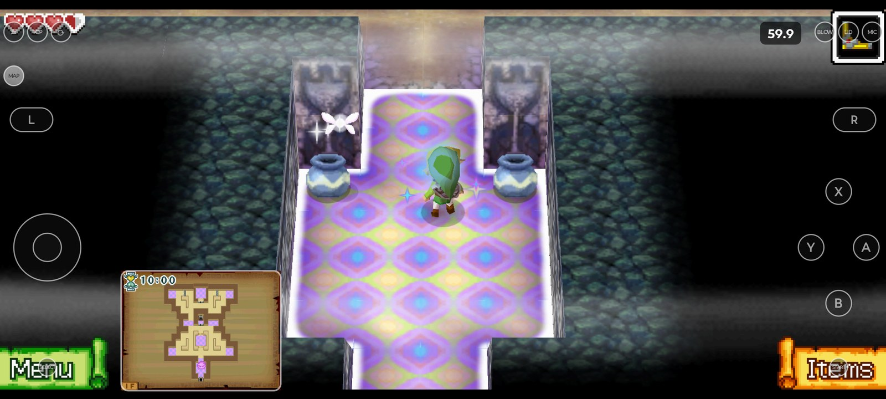

# Phantom Hourglass Recomp

A native port of **The Legend of Zelda: Phantom Hourglass** (Nintendo DS) to Windows, Linux and Android. The game's
ARM9 code is statically recompiled to C and compiled ahead of time instead of emulated; the rest of the DS comes from
[melonDS](https://github.com/melonDS-emu/melonDS).

> **No game data is included.** You build the game from your own dump. Please don't share the builds you make: the
> game folder and the APK contain the game.

<p>
  
</p>
<p>
  
  
</p>
<p>
  
</p>

## Features

- Software, OpenGL and Compute renderers, up to 8x on PC and 4x on Android
- Widescreen (16:9 and 21:9) with Compute
- HD dialogue text (vector font at screen resolution)
- 67 offline achievements with a Trophies viewer (matching RetroAchievements set #14323)
- 12 save-state slots, plus Continue from where you quit
- Language selector: English, French and Spanish, plus German and Italian on Europe dumps
- Touch, keyboard and gamepad; analog-stick movement; mic and blow buttons
- Android: movable on-screen controls, portrait mode with both screens stacked
- Android: a minimap of the other screen in the bottom-left corner (landscape), like a game's corner map: tap it to
  swap the screens, hold it to move it, pinch it to resize it, or hide it with the MAP button. It moves above dialogue
  boxes and hides in cutscenes.
- Temple of the Ocean King floor checkpoints: every floor Link reaches is remembered, and 1F's stairs down can take
  him straight to any of them (see below)

Tested devices and fps measurements: [docs/TESTED.md](docs/TESTED.md).

Ideas and features being considered next: [docs/WISHLIST.md](docs/WISHLIST.md).

## What you need

- Your own dump. Supported (checked by SHA-1):

  | Dump | SHA-1 |
  |---|---|
  | USA | `4c8f52dd719918bbcd46e73a8bae8628139c1b85` |
  | USA, D-pad patch | `7e0d26d143992f1eee182b24f1abb9e7f038eacf` |
  | USA, Button controls patch | `8915d99da2dd99bd2c05bc7a79fd2660a5e8ce5e` |
  | Europe | `02be55db55cf254bd064d2b3eb368b92a5b4156d` |
  | Europe, D-pad patch | `8e3bbda6056c47f06fecf1a06d9f144a19283d88` |

  With a clean dump the D-pad doesn't move Link (the patch adds that); turn on **Analog stick** in the menu instead.
- Windows 10/11 64-bit or Linux, about 10 GB of disk, and an OpenGL 3.3 GPU for the GPU renderer.
- For Android: an Android 8+ arm64 phone (OpenGL ES 3.2 for the GPU renderer) and a USB cable.

## Quick start (new to this?)

You build the game on a Windows PC from your own copy of the game. It takes about an hour the first time, mostly
waiting. Step by step:

1. **Install Git** (to download this project): open the Start menu, type `PowerShell`, open it, and paste this line
   (right-click pastes), then press Enter:
   ```powershell
   winget install --id Git.Git -e
   ```
   Close PowerShell and open it again afterwards.
2. **Make a folder for everything**, for example `C:\Games\ph-workspace`, and inside it a folder named `roms`. Put
   your Phantom Hourglass dump in `roms` (any file name).
3. **Download the project** into that folder. In PowerShell, paste these two lines (change the path if you used another
   folder):
   ```powershell
   cd C:\Games\ph-workspace
   git clone --recurse-submodules https://github.com/dguillot-gh/phantom-hourglass-recomp.git ph-recomp
   ```
   Don't use GitHub's green "Download ZIP" button: the ZIP leaves out melonDS, and the build then fails.
   The folder should now look like this:
   ```
   C:\Games\ph-workspace\
     ph-recomp\           (the project)
     roms\your-dump.nds   (your game)
   ```
4. **Build it** (installs the build tools the first time; Windows asks for admin once):
   ```powershell
   powershell -NoProfile -ExecutionPolicy Bypass -File ph-recomp\scripts\RUN-ALL.ps1
   ```
   When it says it's done, open `C:\Games\ph-workspace\games\PhantomHourglass\` and double-click
   `PhantomHourglass.exe` (`PLAY.cmd` does the same). That folder is the whole game: move it anywhere you like.
5. **For an Android phone:**
   - Turn on USB debugging once: Settings → About phone → tap **Build number** seven times; then Settings → System →
     Developer options → **USB debugging** on.
   - Plug the phone into the PC with a USB cable and tap **Allow** on the phone when it asks.
   - In the same PowerShell window:
     ```powershell
     powershell -NoProfile -ExecutionPolicy Bypass -File ph-recomp\scripts\RUN-ANDROID.ps1
     ```
     It builds the app, installs it and copies your game in. Without a cable, add `-NoPhone`: it only makes the app (in
     `apks\`); copy that file to the phone, tap it to install, and pick your ROM on the app's start screen.

**If something goes wrong:** the script stops with a `FAIL` line that says what's missing. Every step's full output is
in the `logs\` folder; attach the newest log when you [open an issue](../../issues). Don't attach your ROM.

## Building

The short version, for people who already use Git and PowerShell.


Put the repository and your ROM side by side:

```
workspace/
  ph-recomp/          (this repository)
  roms/your-dump.nds  (any name)
```

**Windows**

```powershell
git clone --recurse-submodules <this repository> ph-recomp
powershell -NoProfile -ExecutionPolicy Bypass -File ph-recomp\scripts\RUN-ALL.ps1
```

This installs the build tools, builds the game and makes a `PhantomHourglass\` folder; run its `PLAY.cmd`. For the phone,
run `scripts\RUN-ANDROID.ps1` next. Every script takes `-DryRun`. Details and what each script changes on your PC:
[scripts/README.md](scripts/README.md).

**Linux**

```sh
nix develop --command ./scripts/build-linux.sh
nix develop --command games/PhantomHourglass/play.sh
```

Without Nix, install CMake 3.28+, Ninja, GCC and SDL3's build dependencies, then run `./scripts/build-linux.sh --rom
<path>`. Details: [scripts/README-LINUX.md](scripts/README-LINUX.md).

## Controls

**PC:** mouse is the stylus. Arrows = D-pad, X/Z/S/A = A/B/X/Y, Q/W = L/R, Enter/Right Shift = Start/Select.
M = mic (shout), N = blow, C = close the lid. F1 or Esc opens the menu. F5/F8 save/load a state, F9 continues.
Tab/F2 switch screens, F11 fullscreen, \` (hold) fast-forward. Gamepads work too.

**Android:** touch is the stylus. The small buttons are the menu (≡), TOP (top screen), ⟳ (portrait), MAP (the minimap), MIC, BLOW and
LID.
The menu has the renderer, save states and "Move and resize controls".

**Temple of the Ocean King checkpoints:** every floor Link walks down to is remembered (in `temple_floors.txt`, in
the data folder). Once he has been past B1, the Entry Hall (before 1F) shows *1F Stairs Down: B1 (L)* at the top of
the screen: press L to step through the floors reached (B1, then the deeper ones). Then go down to 1F as usual, where
the sand timer starts, and 1F's stairs down lead to the floor picked instead of B1. Link arrives as if he had come
down that floor's own stairs: the floor starts fresh, and keys from floors above are not carried down. L is used only
while the picker is shown; R and everything else go to the game. The floors are kept for every save file alike.

## Testing and reporting issues

Known issues and the devices it's been tested on are in [docs/TESTED.md](docs/TESTED.md).

Found a bug? [Open an issue](../../issues) and include:

- **Where:** PC (Windows or Linux) or phone, with the phone model
- **Settings:** renderer (Software, OpenGL or Compute), resolution, widescreen on or off
- **Dump:** USA or Europe, clean or D-pad patch
- **What happened:** the steps to get there, plus a screenshot or a save state if you can
- **Logs:** build problems: the log in the workspace's `logs/` folder. Game problems on Android: `adb logcat` output.

Please don't attach your ROM or any game files.

**For contributors:** the unit tests need no ROM. After building, run `ctest --preset release` (Windows) or
`ctest --preset linux-release` (Linux). On Windows, `scripts\4-TEST.ps1` also plays the game for a minute as a smoke
test. Before a PR that touches settings or menus, check both the PC menu and the Android menu and settings.

## How it works

`ntr-recomp` turns the ROM's functions into C, which compiles into a game module that `ntr-runtime` runs natively,
with melonDS providing the rest of the DS hardware. Porting notes: [PH-PORT.md](PH-PORT.md).

## Credits and licence

Recompiler and runtime from [FFCCEOT-Recomp](https://github.com/JonathanDC64/FFCCEOT-Recomp) by JonathanDC64; DS
hardware from [melonDS](https://github.com/melonDS-emu/melonDS); function boundaries from the
[zeldaret/ph](https://github.com/zeldaret/ph) decompilation. Details in [NOTICE.md](NOTICE.md).

GPL-3.0 ([LICENSE](LICENSE)). *The Legend of Zelda: Phantom Hourglass* is © Nintendo; this project is not affiliated
with or endorsed by Nintendo.
