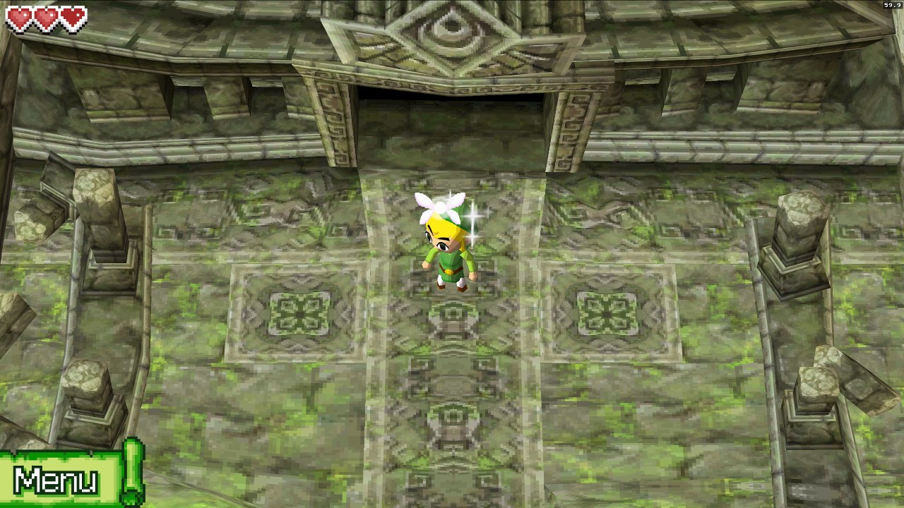
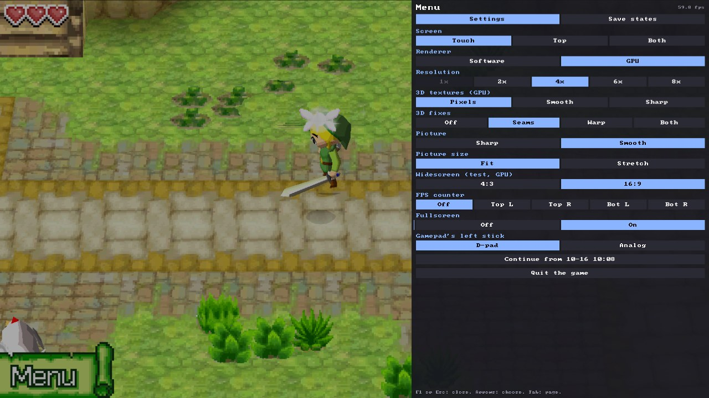

# Phantom Hourglass Recomp

A native port of **The Legend of Zelda: Phantom Hourglass** (Nintendo DS) to Windows, Linux and Android. The game's
ARM9 code is statically recompiled to C and compiled ahead of time instead of emulated; the rest of the DS comes from
[melonDS](https://github.com/melonDS-emu/melonDS).

> **No game data is included.** You build the game from your own dump. Please don't share the builds you make: the
> game folder and the APK contain the game.

<p>
  
</p>
<p>
  
  
</p>

## Features

- Software, OpenGL and Compute renderers, up to 8x on PC and 4x on Android
- Widescreen (16:9 and 21:9) with Compute
- HD dialogue text (vector font at screen resolution)
- 67 offline achievements with a Trophies viewer (matching RetroAchievements set #14323)
- 12 save-state slots, plus Continue from where you quit
- Language selector: English, French and Spanish, plus German and Italian on Europe dumps
- Touch, keyboard and gamepad; analog-stick movement; mic and blow buttons
- Android: movable on-screen controls, portrait mode with both screens stacked

Tested devices and fps measurements: [docs/TESTED.md](docs/TESTED.md).

## What you need

- Your own dump. Supported (checked by SHA-1):

  | Dump | SHA-1 |
  |---|---|
  | USA | `4c8f52dd719918bbcd46e73a8bae8628139c1b85` |
  | USA, D-pad patch | `7e0d26d143992f1eee182b24f1abb9e7f038eacf` |
  | Europe | `02be55db55cf254bd064d2b3eb368b92a5b4156d` |
  | Europe, D-pad patch | `8e3bbda6056c47f06fecf1a06d9f144a19283d88` |

  With a clean dump the D-pad doesn't move Link (the patch adds that); turn on **Analog stick** in the menu instead.
- Windows 10/11 64-bit or Linux, about 10 GB of disk, and an OpenGL 3.3 GPU for the GPU renderer.
- For Android: an Android 8+ arm64 phone (OpenGL ES 3.2 for the GPU renderer) and a USB cable.

## Building

Put the repository and your ROM side by side:

```
workspace/
  ph-recomp/          (this repository)
  roms/your-dump.nds  (any name)
```

**Windows**

```powershell
git clone --recurse-submodules <this repository> ph-recomp
powershell -NoProfile -ExecutionPolicy Bypass -File ph-recomp\scripts\RUN-ALL.ps1
```

This installs the build tools, builds the game and makes a `PhantomHourglass\` folder; run its `PLAY.cmd`. For the phone,
run `scripts\RUN-ANDROID.ps1` next. Every script takes `-DryRun`. Details and what each script changes on your PC:
[scripts/README.md](scripts/README.md).

**Linux**

```sh
nix develop --command ./scripts/build-linux.sh
nix develop --command games/PhantomHourglass/play.sh
```

Without Nix, install CMake 3.28+, Ninja, GCC and SDL3's build dependencies, then run `./scripts/build-linux.sh --rom
<path>`. Details: [scripts/README-LINUX.md](scripts/README-LINUX.md).

## Controls

**PC:** mouse is the stylus. Arrows = D-pad, X/Z/S/A = A/B/X/Y, Q/W = L/R, Enter/Right Shift = Start/Select.
M = mic (shout), N = blow, C = close the lid. F1 or Esc opens the menu. F5/F8 save/load a state, F9 continues.
Tab/F2 switch screens, F11 fullscreen, \` (hold) fast-forward. Gamepads work too.

**Android:** touch is the stylus. The small buttons are the menu (≡), TOP (top screen), ⟳ (portrait), MIC, BLOW and LID.
The menu has the renderer, save states and "Move and resize controls".

## Testing and reporting issues

Known issues and the devices it's been tested on are in [docs/TESTED.md](docs/TESTED.md).

Found a bug? [Open an issue](../../issues) and include:

- **Where:** PC (Windows or Linux) or phone, with the phone model
- **Settings:** renderer (Software, OpenGL or Compute), resolution, widescreen on or off
- **Dump:** USA or Europe, clean or D-pad patch
- **What happened:** the steps to get there, plus a screenshot or a save state if you can
- **Logs:** build problems: the log in the workspace's `logs/` folder. Game problems on Android: `adb logcat` output.

Please don't attach your ROM or any game files.

**For contributors:** the unit tests need no ROM. After building, run `ctest --preset release` (Windows) or
`ctest --preset linux-release` (Linux). On Windows, `scripts\4-TEST.ps1` also plays the game for a minute as a smoke
test. Before a PR that touches settings or menus, check both the PC menu and the Android menu and settings.

## How it works

`ntr-recomp` turns the ROM's functions into C, which compiles into a game module that `ntr-runtime` runs natively,
with melonDS providing the rest of the DS hardware. Porting notes: [PH-PORT.md](PH-PORT.md).

## Credits and licence

Recompiler and runtime from [FFCCEOT-Recomp](https://github.com/JonathanDC64/FFCCEOT-Recomp) by JonathanDC64; DS
hardware from [melonDS](https://github.com/melonDS-emu/melonDS); function boundaries from the
[zeldaret/ph](https://github.com/zeldaret/ph) decompilation. Details in [NOTICE.md](NOTICE.md).

GPL-3.0 ([LICENSE](LICENSE)). *The Legend of Zelda: Phantom Hourglass* is © Nintendo; this project is not affiliated
with or endorsed by Nintendo.
