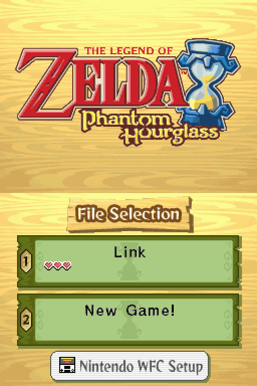
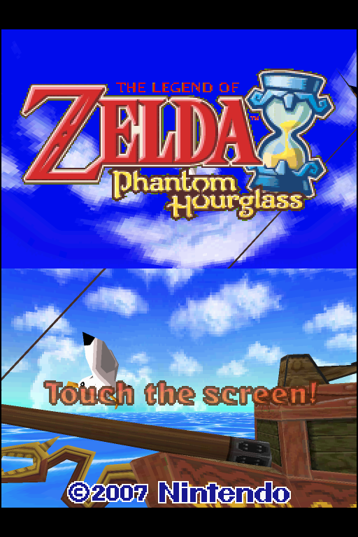

# Phantom Hourglass Recomp

A native port of **The Legend of Zelda: Phantom Hourglass** (Nintendo DS) to Windows PCs and Android phones, made by
*static recompilation*: the game's own ARM9 code (the main program and all 62 overlays, 24,621 functions) is translated
to C and compiled ahead of time for your machine, instead of being emulated. The rest of the console (the ARM7, graphics
and sound hardware) comes from the [melonDS](https://github.com/melonDS-emu/melonDS) core.

> **This repository contains no game data.** You build the game from your own legally dumped cartridge: the scripts
> recompile your ROM on your PC, and nothing made from it is ever committed or shared. Please do not share the builds
> you make (the game folder and the APK contain the game).

## Features

- **Single-screen play**: the touch screen fills the window or the phone; the top screen (the sea map) is a key or a
  tap away, or both screens stacked.
- **Upscaling**: a GPU renderer draws 2D and 3D at 2x-8x on a PC, 2x-6x on a phone (OpenGL ES 3.2), or the DS's exact
  picture with the software renderer. Sharp or smooth filtering; fit (the DS's shape) or stretched to the screen.
- **Save states**: 12 slots with a picture of each, on PC and phone. A state never touches the game's own save.
- **Android**: touch is the stylus; an on-screen D-pad (the D-pad patch moves Link with it), optional A B X Y, L R,
  Start/Select; Mic, Lid, Top-screen and Rotate buttons; portrait mode with both screens like a DS held open; gamepads.
- **The microphone and the lid** (the game asks you to blow out candles and to close the DS) are a key or a button.
- An FPS counter, a side menu on both platforms, and the game's own saves kept as `.sav` files.

<p>
  
  
</p>

## Tested on

- **Phone:** Google Pixel 8. Other phones should work (Android 8 or newer, 64-bit ARM) but have not been tried, and GPU
  drivers differ: if the picture looks wrong, the software renderer (1x, in the menu) is the safe fallback.
- **PC:** Windows 11.
- **Status:** plays on PC and on the Pixel 8. On the phone the GPU renderer at 6x can stutter once the phone warms up; 3x holds a steady 60 fps.

## What you need

- Your own dump of the game. Supported (checked by SHA-1):

  | Dump | SHA-1 |
  |---|---|
  | Phantom Hourglass (USA) | `4c8f52dd719918bbcd46e73a8bae8628139c1b85` |
  | Phantom Hourglass (USA), D-pad patch | `7e0d26d143992f1eee182b24f1abb9e7f038eacf` |

- Windows 10 or 11 (64-bit), about 10 GB of disk for the tools and the build. An OpenGL 3.3 graphics card for the GPU
  renderer (the software renderer needs nothing special).
- For the phone: an Android 8+ phone (arm64; the GPU renderer needs OpenGL ES 3.2) and a USB cable.

## Building it

Clone the repository into a folder of its own (the *workspace*), put your ROM in the workspace, and run the scripts in
`ph-recomp\scripts`:

```
workspace\
  ph-recomp\              (this repository)
  your-dump.nds           (any name: the scripts find it by its SHA-1)
```

```powershell
git clone --recurse-submodules <this repository> ph-recomp
powershell -NoProfile -ExecutionPolicy Bypass -File ph-recomp\scripts\RUN-ALL.ps1
```

`RUN-ALL.ps1` installs the build tools with winget (Git, Python, CMake, Ninja, LLVM, Visual Studio Build Tools; asks for
admin once), recompiles your ROM and builds the game, makes a ready-to-play `PhantomHourglass\` folder in the workspace
and plays it for a minute by itself as a test. Then double-click `PhantomHourglass\PLAY.cmd`.

For the phone, after that:

```powershell
powershell -NoProfile -ExecutionPolicy Bypass -File ph-recomp\scripts\RUN-ANDROID.ps1
```

It gets Java 17 and the Android SDK if you do not have them (asking you to accept Android's SDK licence), builds the
APK and installs it on the phone over USB debugging, with your ROM. Every script takes `-DryRun` to check everything
without installing or building anything. The step-by-step guide is [scripts/README.md](scripts/README.md).

## What the scripts do to your PC

The scripts are plain text in `scripts\`: read any of them before running it. Add `-DryRun` to any script to see what
it would do without installing or building anything. Each one writes a log to `logs\` in the workspace (the folder
that holds this repository).

| Script | What it does | What it changes on your PC |
|---|---|---|
| `1-INSTALL-TOOLS.ps1` | Checks for the build tools; installs the missing ones with winget (Windows' package manager) | Installs Git, Python 3, CMake, Ninja, LLVM and Visual Studio 2022 Build Tools (C++ and the Windows SDK): ordinary programs, removable in Settings > Apps. Build Tools and the SDK ask for admin once. |
| `ANDROID-TOOLS.ps1` | Uses the Java 17 and Android SDK you already have, or gets them | Java 17 (Microsoft OpenJDK, winget); Google's Android command-line tools and SDK parts (platform 35, NDK) into the tools folder. Shows Android's licence for you to accept. |
| `2-BUILD.ps1` | Recompiles your ROM's code to C and compiles the game and the program | Reads your ROM, never changes it. Downloads melonDS and SDL3 from GitHub the first time. Writes only inside `ph-recomp\build`. |
| `3-MAKE-GAME-FOLDER.ps1` | Makes `PhantomHourglass\` in the workspace: the game, ready to play | Copies the program and your ROM there; never overwrites a save. |
| `4-TEST.ps1` | Plays the game by itself for about a minute and takes screenshots | Works on copies of your save, in the logs folder. |
| `5-BUILD-ANDROID.ps1` | Builds the phone app (APK) into `apks\` | Gradle downloads Android libraries from Google and Maven Central the first time. |
| `6-INSTALL-PHONE.ps1` | Installs the app on your phone over USB | Copies your ROM into the app, and a save only if the phone has none; never replaces a save on the phone. |
| `RUN-ALL.ps1`, `RUN-ANDROID.ps1` | Run the steps above in order, stopping at the first that fails | Nothing more than the steps they run. |
| `ci-build.ps1` | For a build PC that makes the APK by itself on every push ([BUILD-PC.md](scripts/BUILD-PC.md)) | Uploads the APK to a private GitHub repository you name. No other script runs it. |

Nothing is uploaded or sent anywhere (except by `ci-build.ps1`, which only runs when you start it on purpose). Nothing is left running in the background or set to start with Windows, and
no system settings are changed beyond what the installers above do themselves. Everything the build makes stays in the
workspace and the tools folder.

## Playing on a PC

| Input | Does |
|---|---|
| Mouse (left button) | the stylus, on the touch screen |
| Arrows, or a gamepad's D-pad or left stick | D-pad |
| X, Z, S, A | A, B, X, Y (a gamepad by position: A is the right face button) |
| Q, W / Enter, Right Shift | L, R / Start, Select |
| **M** (hold), or the right stick's click | blow into the microphone |
| **C** (hold) | close the DS's lid |
| **F1** or Esc | the menu: screen, renderer and resolution, picture, FPS counter, fullscreen, save states, quit |
| **F5** / **F8** | save a state to the chosen slot / load it |
| Tab / F2 | the other screen / both screens |
| F3 / F4 / F11 / F12 | sharp or smooth / FPS counter / fullscreen / screenshot |
| ` (hold) | fast-forward |

## Playing on a phone

Touch the game: it is the stylus. The small buttons are the menu (≡), TOP (the top screen), ⟳ (portrait, both
screens), MIC (hold to blow) and LID. The menu switches each control on or off, sets their size and opacity, and has
the renderer, resolution, picture size, FPS counter (drag it anywhere) and the 12 save state slots.

## How it works

`ntr-recomp` reads the ROM, finds every function (boundaries from the zeldaret decompilation's analysis) and writes
them as C; that C is compiled into a game module (`ph_game.dll`, `libph_game.so` on Android) that `ntr-runtime` loads.
The runtime runs the recompiled code natively and drives melonDS for everything else: timers, DMA, interrupts, the
ARM7, the cartridge, the 2D and 3D engines. The game's threads run on host fibers; code the game builds at run time
runs on melonDS's interpreter. Porting notes: [PH-PORT.md](PH-PORT.md).

| Folder | What |
|---|---|
| `frontend/` | the program (PC and Android), the menu, save states, Phantom Hourglass's hooks, `config/azee` |
| `android/` | the Android app: launcher, on-screen pad, menu |
| `recompiler/` | `ntr-recomp`: ARM/Thumb decoder, function discovery, C emitter |
| `runtime/` | `ntr-runtime`: the DS around the recompiled code (melonDS), threads, save states |
| `common/` | ROM reading, SHA-1, the supported dumps |
| `third_party/` | melonDS (submodule) and its build glue, the OpenGL ES shader conversion; SDL3 is fetched at build time |
| `scripts/` | the build scripts |
| `tools/` | the copyright guard, the OpenGL ES shader check, the icon, the function list importer |

## Credits and licence

The recompiler and runtime come from [FFCCEOT-Recomp](https://github.com/JonathanDC64/FFCCEOT-Recomp) by JonathanDC64,
used as the engine of this fork; the frontend and the Android app are this project's own. The DS hardware model is
[melonDS](https://github.com/melonDS-emu/melonDS). Function boundaries come from the
[zeldaret/ph](https://github.com/zeldaret/ph) decompilation project. Details in [NOTICE.md](NOTICE.md).

GPL-3.0 ([LICENSE](LICENSE)). *The Legend of Zelda: Phantom Hourglass* is © Nintendo; this project is not affiliated
with or endorsed by Nintendo.
